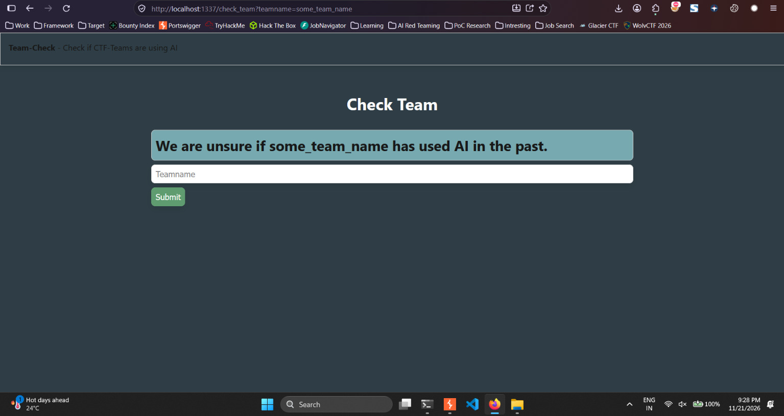
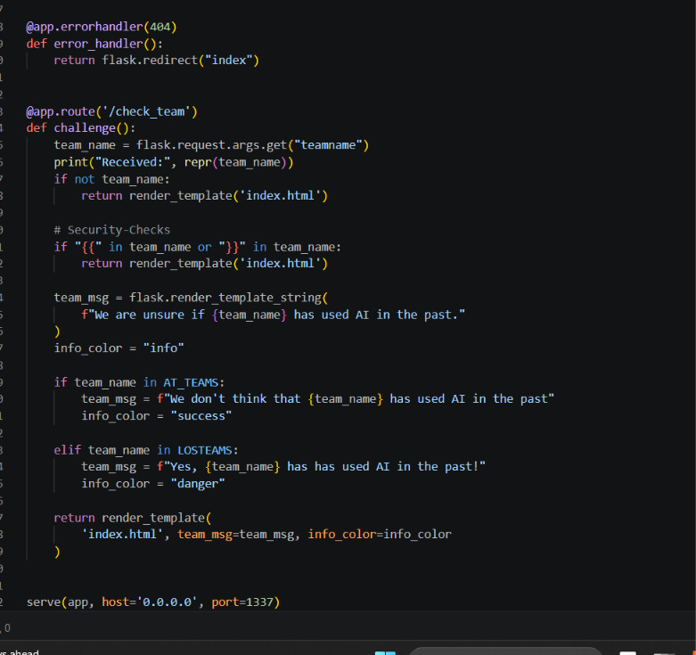
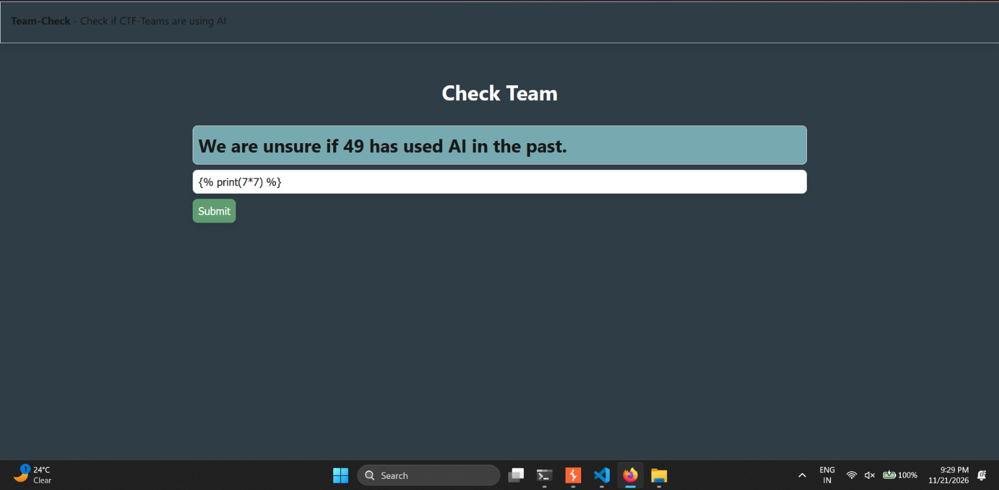
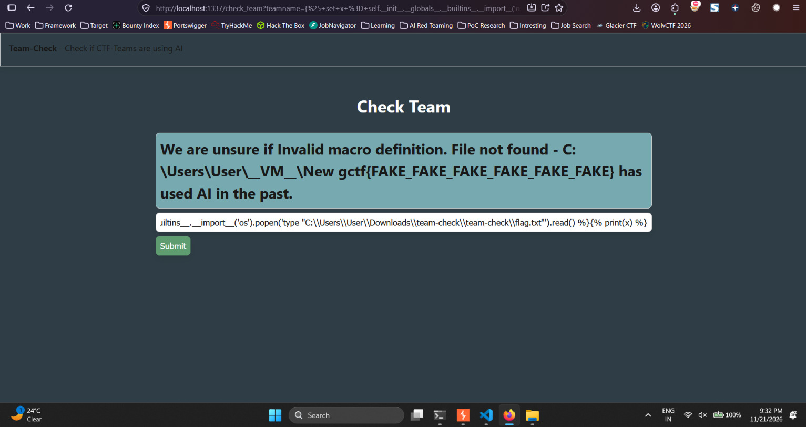

# Team-Check — Server-Side Template Injection (SSTI) Writeup

Team-Check — Server-Side Template Injection (SSTI) Writeup

Nov 21, 2026

Overview

The challenge, Team-Check, is a Flask app that reflects a teamname query parameter into a rendered template to tell a CTF team whether it has "used AI in the past." The app tries to block Server-Side Template Injection (SSTI) by rejecting any input containing the literal substrings {{ or }} before rendering it with flask.render_template_string().

That filter only blocks Jinja2's expression delimiters. It does nothing to stop Jinja2's statement delimiters, , which are just as capable of executing Python. By using  instead of {{ ... }}, the filter is bypassed entirely, confirmed first with a harmless 7*7 math check and then escalated to arbitrary code execution to read flag.txt — first on a local Windows test copy of the app, then against the live (likely Linux) challenge server.

Step 1 — Recon

The challenge provided the app's source code (app.py + templates), so it was run locally using the provided files and reached at:

```python
http://localhost:1337/check_team?teamname=some_team_name
```



Visiting the page (Check Team) showed a single-purpose form: a text box for a team name, a Submit button, and a banner reading:

We are unsure if {teamname} has used AI in the past.

Submitting some_team_name simply echoed it back into that sentence: "We are unsure if some_team_name has used AI in the past." The team name was clearly being reflected verbatim into the page — the first signal worth checking for template injection, since Flask apps commonly build such responses with render_template_string() on user input.

Step 2 — Source code review

The challenge also provided app.py. The relevant route:

```python
@app.errorhandler(404)def error_handler():    return flask.redirect("index")@app.route('/check_team')def challenge():    team_name = flask.request.args.get("teamname")    print("Received:", repr(team_name))    if not team_name:        return render_template('index.html')    # Security-Checks    if "{{" in team_name or "}}" in team_name:        return render_template('index.html')    team_msg = flask.render_template_string(        f"We are unsure if {team_name} has used AI in the past."    )    info_color = "info"    if team_name in AT_TEAMS:        team_msg = f"We don't think that {team_name} has used AI in the past"        info_color = "success"    elif team_name in LOSTEAMS:        team_msg = f"Yes, {team_name} has has used AI in the past!"        info_color = "danger"    return render_template(        'index.html', team_msg=team_msg, info_color=info_color    )serve(app, host='0.0.0.0', port=1337)
```



Two things stand out:

team_name is dropped straight into an f-string, and that f-string is passed to flask.render_template_string() — a textbook SSTI sink, since the entire string (attacker input included) is compiled and rendered as a Jinja2 template.

The only defense is the Security-Checks block: a plain substring test rejecting {{ or }}. There is no sandboxing, no character allowlist, and no check on , or any other Jinja syntax.

Step 3 — Vulnerability analysis

Jinja2 has three kinds of delimiters:

| Delimiter | Purpose |
| --- | --- |
| {{ ... }} | Expressions (print a value) |
|  | Statements (if, for, set, print, include, ...) |
| {# ... #} | Comments |

The filter checked only for the first pair. Since Jinja2's  statement tags can do everything an expression can — including calling functions and printing their result via the print() statement — the fix is: never use {{ }} at all, and do everything through .

The plan going in:

Confirm the bypass works at all with a harmless arithmetic check:  should render 49 if executed, or literally show up unrendered / get blocked if not.

If that works, pivot to the standard Jinja2 sandbox-escape gadget (self.__init__.__globals__.__builtins__) to reach Python's __builtins__, import os, and run shell commands via os.popen(...).read().

Use that to read flag.txt.

Step 4 — Proof of concept

Submitted as the teamname parameter:

```python

```



The response banner changed from echoing the raw string to showing:

We are unsure if 49 has used AI in the past.

This confirmed two things at once: the {{/}} substring filter was fully bypassed (no {{ or }} ever appeared in the payload), and the input was being executed as a Jinja2 template, not just string-formatted — arbitrary Python expressions could now be evaluated server-side via print(...) inside a  block.

Step 5 — Local file read (Windows test copy)

With the app running locally via python app.py (Windows, PowerShell), the first idea was Jinja's  tag, since it reads files through the template loader without ever touching {{ }}:

```python

```

This failed with jinja2.exceptions.TemplateNotFound: ../flag.txt. The same happened for an absolute path and for a bare app.py. The reason: Jinja2's loader explicitly rejects any path segment equal to .. before even touching the filesystem, and on Windows, ntpath.join() doesn't anchor a C:/...-style "absolute" path the way Linux does — it gets silently appended onto the existing templates/ search path instead of replacing it. In short,  could not be made to escape the templates directory on this target.



Pivot to code execution. Since {{ }} is filtered but  is not, the classic Jinja2 sandbox-escape gadget was used inside a  /  pair to reach Python's os module through the object graph exposed by self.__init__.__globals__.__builtins__:

```python

```

Key details that made this work:

self.__init__.__globals__ reaches the Python module globals from inside the Jinja2 render context, giving access to __builtins__ and from there __import__.

type is the Windows cmd.exe equivalent of cat; popen() spawns a shell, so Windows built-ins like type work even though they aren't standalone executables.

The path used double backslashes (\\) because this is a Python string literal being built inside the template, not a Jinja template path — a different context from the include tag above, so the loader's backslash/.. restrictions didn't apply here.

This payload successfully returned the contents of the local flag.txt, confirming full remote code execution via the SSTI.

Step 6 — Adapting for the remote (Linux) server

The live challenge server is almost certainly Linux, so the payload needed three changes: swap the Windows shell command for its Linux equivalent, use forward slashes, and not assume the same file path as the local copy.

Baseline payload, assuming a flag at the filesystem root:

```python

```

Since the exact path wasn't known in advance on the remote target, a discovery payload was used first to locate it instead of guessing blindly:

```python

```

find / -iname "flag*" searches the whole filesystem case-insensitively for anything named flag*, and 2>/dev/null suppresses permission-denied noise so the real hit stands out in the response. Once the path was confirmed, cat was pointed directly at it to retrieve the flag from the live server, using the same  /  SSTI gadget that worked locally — the only thing that changed between the local and remote exploitation was the underlying OS command and path, not the injection technique itself.

Appendix

Payloads tried, in order

| # | Payload | Result |
| --- | --- | --- |
| 1 | {{7*7}} | Blocked by the {{/}} substring filter |
| 2 |  | Rendered 49 — confirmed SSTI, filter bypassed |
| 3 |  | TemplateNotFound — Jinja2 loader rejects .. path segments outright |
| 4 |  | TemplateNotFound — loader only resolves inside templates/ |
| 5 |  | TemplateNotFound — Windows ntpath.join() appends instead of anchoring an absolute path |
| 6 |  | Success — flag contents returned (local Windows test) |
| 7 |  | Remote Linux equivalent of #6 |
| 8 |  | Discovery payload used when the exact remote path was unknown |

Vulnerable code (full)

```python
@app.errorhandler(404)def error_handler():    return flask.redirect("index")@app.route('/check_team')def challenge():    team_name = flask.request.args.get("teamname")    print("Received:", repr(team_name))    if not team_name:        return render_template('index.html')    # Security-Checks    if "{{" in team_name or "}}" in team_name:        return render_template('index.html')    team_msg = flask.render_template_string(        f"We are unsure if {team_name} has used AI in the past."    )    info_color = "info"    if team_name in AT_TEAMS:        team_msg = f"We don't think that {team_name} has used AI in the past"        info_color = "success"    elif team_name in LOSTEAMS:        team_msg = f"Yes, {team_name} has has used AI in the past!"        info_color = "danger"    return render_template(        'index.html', team_msg=team_msg, info_color=info_color    )serve(app, host='0.0.0.0', port=1337)
```

Takeaways / remediation

The root cause is a blocklist on raw template syntax instead of a sandboxed renderer or an allowlist on content. Blocking {{/}} stops the most obvious SSTI shape but leaves every other Jinja2 construct open —  statements, {# #} comments used creatively, alternate whitespace, and any future syntax the developer didn't think to block.

A correct fix would do one of the following instead:

Never pass user input into render_template_string() at all. Pass the team name as a template variable (render_template_string("We are unsure if {{ name }} has used AI", name=team_name)) so Jinja2 auto-escapes it as data rather than compiling it as template code.

If dynamic templates are unavoidable, use Jinja2's SandboxedEnvironment, which restricts attribute access to the kind of gadget chain used here (__init__, __globals__, __builtins__).

Treat any character-level blocklist on template syntax as insufficient on its own — it should back a safer renderer, not substitute for one.
